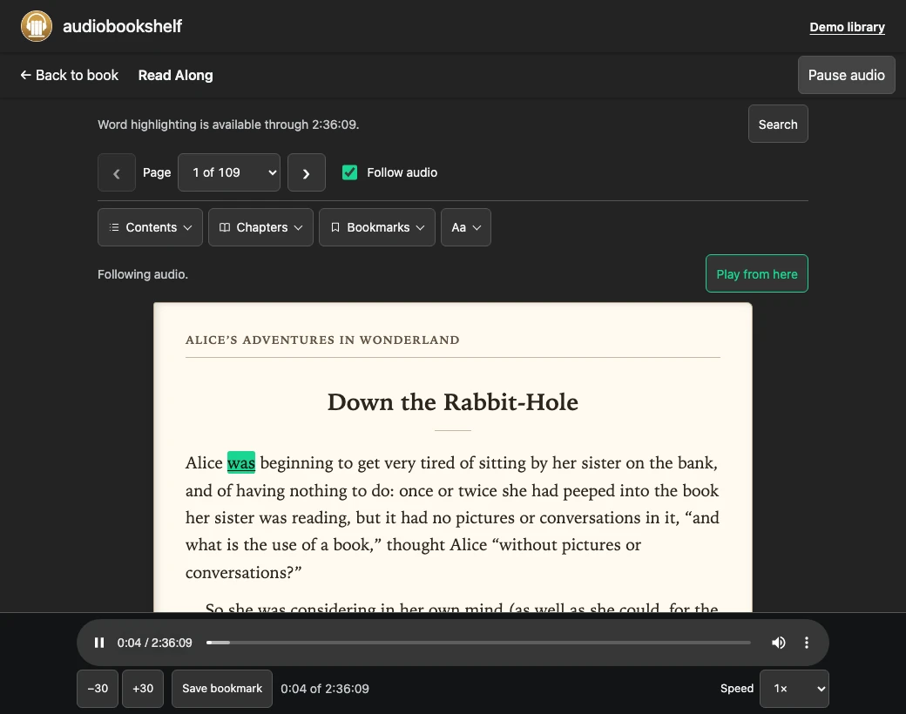
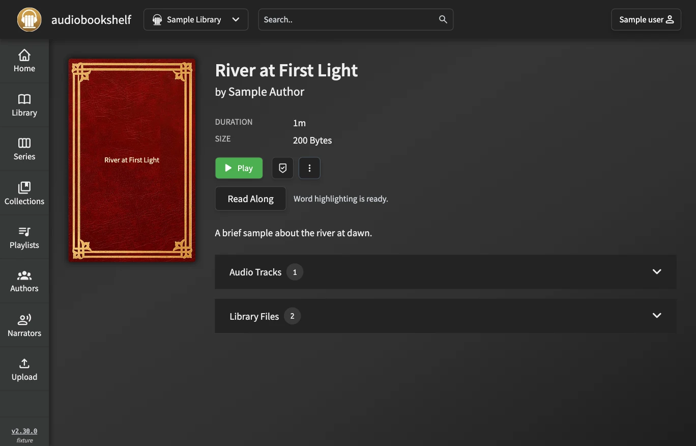
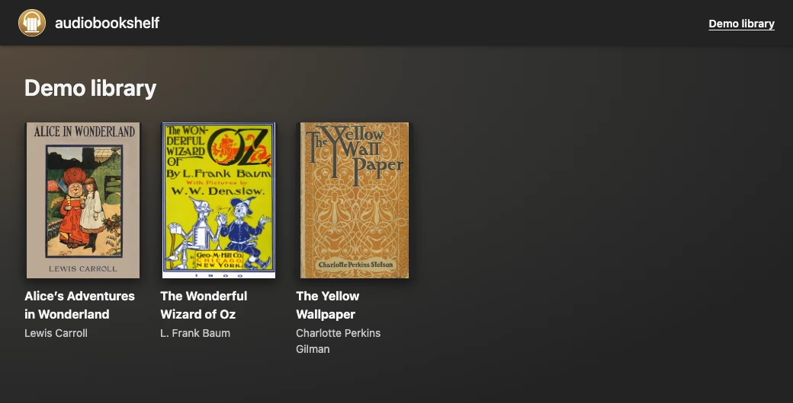

# Audiobookshelf React client

**[Try the live Read Along demo](https://jacquelinedmcgraw.github.io/audiobookshelf-client-react/#library)**

Listen and follow along with three sample books. No installation or sign-in required.

This is my fork of the Audiobookshelf React client. I added [self-hosted Read Along](self-hosted-read-along/README.md) to sync audiobook narration with EPUB or PDF text on your own server.

## Screenshots

**Read Along in the live demo.** Follow the highlighted words as the audiobook plays. Use the chapter menu, search, or bookmarks to find your place.



**Self-hosted Audiobookshelf.** Once a book is synced, **Read Along** appears on its book page. This screenshot uses a sample library.



**Demo library.** Choose from _Alice’s Adventures in Wonderland_, _The Wonderful Wizard of Oz_, and _The Yellow Wallpaper_.



The upstream React client is in active development.

The upstream preview image below is for testing Audiobookshelf itself. To try this fork’s upload and sync feature, follow the [self-hosted setup guide](self-hosted-read-along/README.md).

```
ghcr.io/advplyr/audiobookshelf:v3
```

For testing, it is recommended that you use a separate config & libraries from your production server.

## Contributing

If you plan to contribute upstream, please read the [Audiobookshelf contribution guidelines](https://audiobookshelf.org/docs/contributing/general/). The upstream maintainers ask contributors to run and review their changes, author their own commits, and write their own PR and issue descriptions. They decline PRs and issues that are entirely AI-generated.

### How to run locally

This assumes that you have [audiobookshelf](https://github.com/advplyr/audiobookshelf) locally.

1. Clone my fork with `git clone https://github.com/JacquelineDMcGraw/audiobookshelf-client-react.git`.
2. install dependencies: `cd audiobookshelf-client-react && pnpm i`
3. Start the audiobookshelf server with the `REACT_CLIENT_PATH` env variable set to this project path. Or in the `dev.js` file add `ReactClientPath` to config.
4. In the audiobookshelf server repo run with `npm run dev` as usual. This will serve the NextJS app using HMR.

If you access the dev app through a reverse proxy (not `localhost`), add `AllowedDevOrigins` to your audiobookshelf `dev.js` (mapped to `ALLOWED_DEV_ORIGINS` in `index.js`). Restart the dev server after changing it.

```js
// example dev.js file in audiobookshelf
const Path = require('path')

module.exports.config = {
  ConfigPath: Path.resolve('config'),
  MetadataPath: Path.resolve('metadata'),
  ReactClientPath: Path.resolve('../audiobookshelf-client-react'),
  AllowedDevOrigins: ['your-reverse-proxy-host.example.com']
}
```

### Running in prod

1. `pnpm run build` this NextJS app
2. Start the audiobookshelf server with `npm run start-dev` (uses the dev.js file w/ production)

### Self-hosted Read Along

Pair a DRM-free EPUB or text PDF with audiobook tracks in your library and sync them on your own machine. See the [setup guide and visual walkthrough](self-hosted-read-along/README.md).
